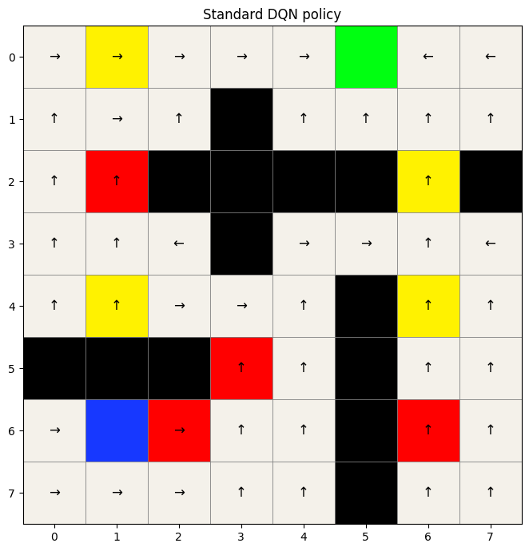
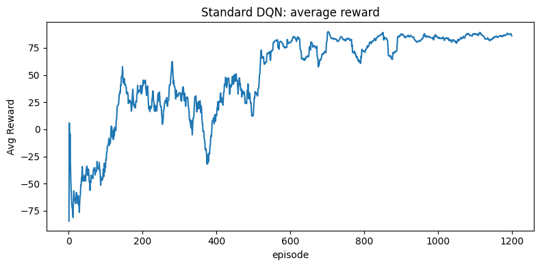

# DQN variants in a stochastic maze

A reinforcement-learning course project implementing standard DQN, Double DQN and Dueling DQN in an 8-by-8 maze with 50 traversable states. The agent observes normalized coordinates, chooses among four movements, and faces stochastic sideways transitions, wall penalties and hazardous cells.

**Main observation:** all three variants produced a successful sampled path. Double DQN had the highest final training reward in the saved run. This is a single-seed comparison, not evidence of general superiority.

## Saved results

The values below are the final 25-episode moving averages from training with random starting states and epsilon-greedy exploration. They are not a separate greedy-policy evaluation or a success-rate estimate.

| Variant | Training reward | Episode length | Summed update loss per episode |
|---|---:|---:|---:|
| Standard DQN | 86.080 | 7.56 | 5.1461 |
| Double DQN | 88.112 | 6.84 | 4.8963 |
| Dueling DQN | 87.624 | 7.52 | 3.6085 |

Source: [saved notebook text outputs](evidence/saved_notebook_outputs.txt), extracted without rerunning the [original notebook](project4.ipynb). The reported loss is accumulated over updates within each episode; smaller loss alone does not establish a better policy.

## Implementation

- Replay capacity 10,000; batch 64; 1,200 episodes; 50-step episode limit.
- Discount 0.99, Adam learning rate 0.001, target soft-update factor 0.01.
- Epsilon schedule `max(0.1, 0.995 ** episode)`.
- Standard DQN uses three 128-unit ReLU hidden layers.
- Double DQN selects the next action with the online network and evaluates it with the target network.
- Dueling DQN uses shared features and separate value/advantage streams.
- A learning-rate comparison is included in the notebook.

## What the results do and do not show

The saved experiment uses seed 0. Algorithm ranking has not been checked across independent training seeds. The path helper retries up to 100 trajectories and returns the first success; its 12-step example is illustrative, not an unbiased estimate of typical path length. No optimal-policy reference or independent policy evaluation is reported.

The standalone legacy filenames `path_figure.png`, `policy_figure.jpg` and `values_figure.jpg` actually contain a university logo, a generic network diagram and the maze layout. The figures used here are genuine notebook outputs extracted into `evidence/`. Original files and [submitted report](project4_report.pdf) are preserved.

## Running

The notebook uses NumPy, Matplotlib, PyTorch and a Jupyter-compatible environment; it is configured for CPU. Run its cells in order to train the baseline, learning-rate comparisons and variants. Original dependency versions are not pinned, and the historical run has not been reproduced for this presentation update. The environment is defined in the notebook; no external dataset is required.

Install dependencies with `python -m pip install -r requirements.txt`. This list is not a lock of the original experiment environment.
